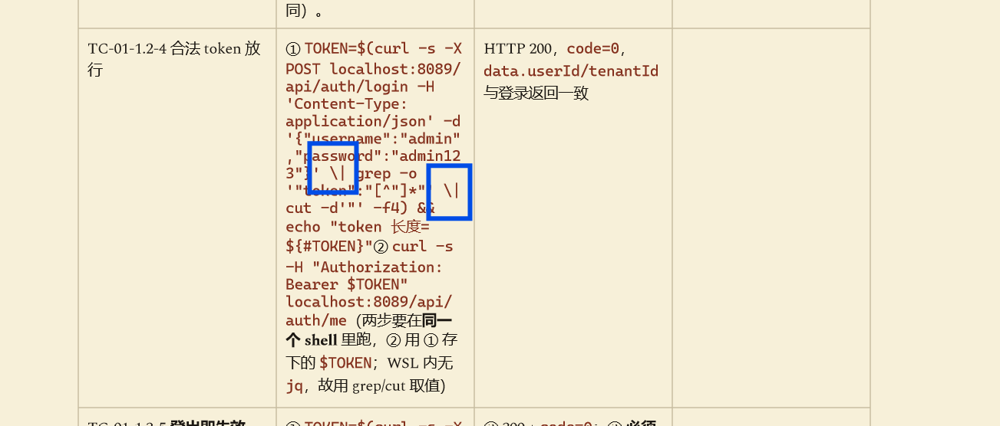

## Sefer的一个问题
- markdown格式中的表格内容里面有 | 符号，Sefer显示的时候没有处理转义符，导致我复制指令执行的时候出错。
原文如下
```
| 用例 | 步骤 | 预期 | 实测 |
| TC-01-1.2-4 合法 token 放行 | ① `TOKEN=$(curl -s -X POST localhost:8089/api/auth/login -H 'Content-Type: application/json' -d '{"username":"admin","password":"admin123"}' \| grep -o '"token":"[^"]*"' \| cut -d'"' -f4) && echo "token 长度=${#TOKEN}"`<br>② `curl -s -H "Authorization: Bearer $TOKEN" localhost:8089/api/auth/me`<br>（两步要在**同一个 shell** 里跑，② 用 ① 存下的 `$TOKEN`；WSL 内无 `jq`，故用 grep/cut 取值） | HTTP 200，`code=0`，`data.userId/tenantId` 与登录返回一致 | |
```
 - Sefer 显示如下



## SSE
今天早上看《# task.3 心脏搭建：统一 AI 网关（阶段2）》的时候，和deepseek开始聊天，它提到一个我完全不知道的概念SSE。
AI 场景下说的 SSE 是 Server-Sent Events，它是 2004 年提出、2014 年随 HTML5 定型、由 WHATWG 维护的单向 HTTP 推送规范，原本为了解决 Web 端的实时服务器推送问题，十几年后被 ChatGPT 用成了 AI 流式输出的默认方案。它不是 IEEE 标准。
### HTTP 层长什么样

客户端发一个普通 HTTP 请求：

```http
GET /api/chat/stream?q=你好 HTTP/1.1
Host: localhost:8080
Accept: text/event-stream
Authorization: Bearer <token>
```

服务端返回：

```http
HTTP/1.1 200 OK
Content-Type: text/event-stream
Cache-Control: no-cache
Connection: keep-alive
X-Accel-Buffering: no
```

关键点：

- `Content-Type: text/event-stream` 是必须的。
- 响应**不结束**，服务端持续往 body 里写。
- 状态码一旦发出就是 `200`，后面出错也不能改成 `500`，只能往流里写错误事件。
- `Cache-Control: no-cache` 防止中间层缓存。
- `X-Accel-Buffering: no` 常用于让 nginx 不缓冲。

### 字段

| 字段 | 作用 | 示例 |
|---|---|---|
| `data:` | 事件数据，可多行 | `data: hello` |
| `event:` | 事件类型，默认是 `message` | `event: delta` |
| `id:` | 事件 ID，用于断线重连 | `id: 42` |
| `retry:` | 重连间隔，毫秒 | `retry: 3000` |
| `:` 开头 | 注释，常做心跳 | `: ping` |

### 一个完整的 HTTP 事务示例

客户端请求：

```http
GET /api/chat/stream?q=你好 HTTP/1.1
Host: localhost:8080
Accept: text/event-stream
Authorization: Bearer abc123
```

服务端响应：

```http
HTTP/1.1 200 OK
Content-Type: text/event-stream
Cache-Control: no-cache
Connection: keep-alive

event: meta
data: {"model":"qwen2.5"}

event: delta
id: 1
data: {"delta":"你"}

event: delta
id: 2
data: {"delta":"好"}

event: delta
id: 3
data: {"delta":"，"}

: ping

event: done
data: {"type":"done"}
```

客户端看到的是：

- 先收到 `meta` 事件。
- 然后连续收到 `delta` 事件，每个带一个 token。
- 中间可能收到 `: ping` 心跳，忽略。
- 最后收到 `done` 事件，知道回答结束。

### 心跳的作用
- 防止连接被中间层掐断, nginx、负载均衡、防火墙、云网关
- 探测连接是否还活着, 客户端
- 帮助服务端释放资源
