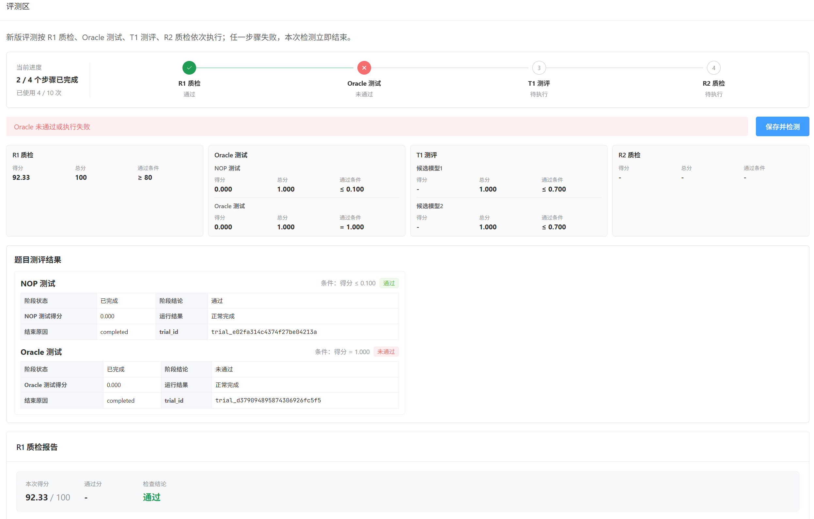
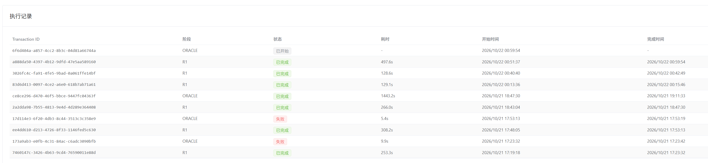

### Harbor框架
因为Talents-ai的项目，我接触到Harbor框架
 - 学习视频 https://meeting.tencent.com/cw/2GjW74OP2d
 - harbor-framework
Harbor is a framework from the creators of Terminal-Bench for evaluating and optimizing agents and language models.
干这个项目实在是耗时间，我感觉我是被600到800时薪吸引进来的，今天是第3天了，还没通过Oracle（神谕）测试。
现在的策略是简化，先看看题目本身能不能让大模型做一做。
安装好harbor之后，可以运行。
`harbor trials start -p ~/exam/beat-llm-001 -a oracle`

### 简略记下它的原理
 - instruction.md: 你出的题目
 - environment目录是用来做题干的，你可以放需要修正的代码。
 - tests: 验证大模型的做题结果，0是错的，1是对的，没有中间值。特别注意的是要防作弊。
 - solution: 放的是你的解题方法，确保题目是有解的。

### Talents-ai平台
平台会有一个自动质检的流程，看起来也是基于智能体打造的，分成4大步

### Tips
 - claude code在vs code的web ide中使用，怎么负责终端的文字到本地电脑
 方法一：使用 Claude Code 内置的 /copy 命令（首选）
 这是最推荐、最干净的方法，因为它绕开了终端渲染可能带来的格式问题（如硬换行和多余空格）。
 直接在 Claude Code 的对话输入框中输入 /copy 并回车，它就会将上一条助手的回复以 Markdown 格式复制到你本地电脑的系统剪贴板。
 复制更早的回复：可以加上数字，例如 /copy 2 会复制倒数第二条回复。
 处理代码块：如果回复中包含多个代码块，/copy 会弹出一个选择器，让你挑选具体的代码块进行复制，而不是一股脑全部复制。

### 复盘一下
今天大部分的时间都是在和docker容器的编排做战斗。估计是我设计的场景比较复杂，搞的评测区的检查一直过不去。
先不要想着我的题目有多牛逼，要先把基础的流程跑通。
Oracle测试那里，启动容器需要新建image，而且失败了也不知道怎么失败。只能靠猜，最后选择优化容器的DockerFile，加速image的创建。
这不符合MVP原则，上来就想憋大招。我应该小步快试，先看看走通一个流程最快是什么样的。记住，无论干啥，都先把end2end走通，哪怕是失败的。
我前两天沉浸在构造题目当中，完全忘了题目是要交付的。
